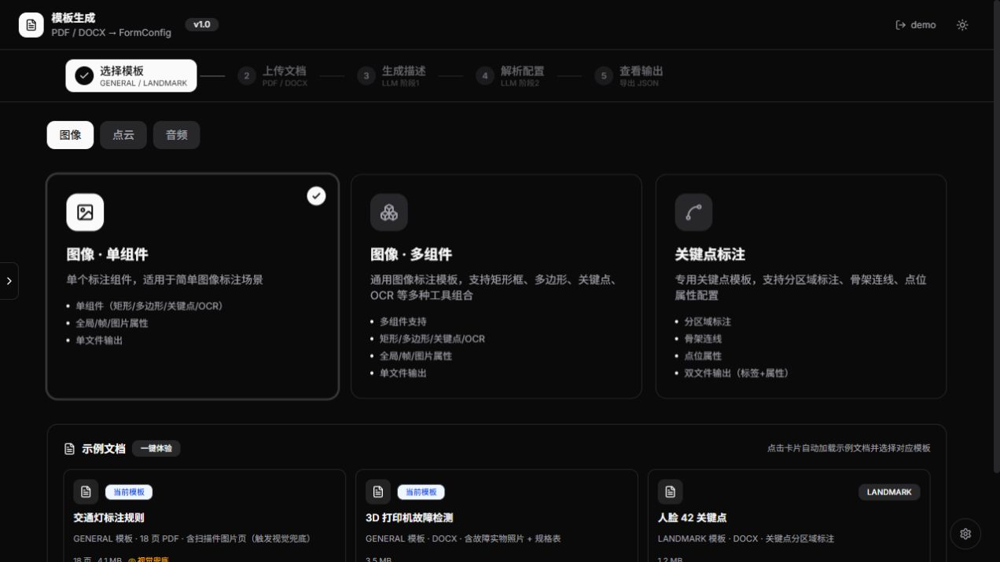
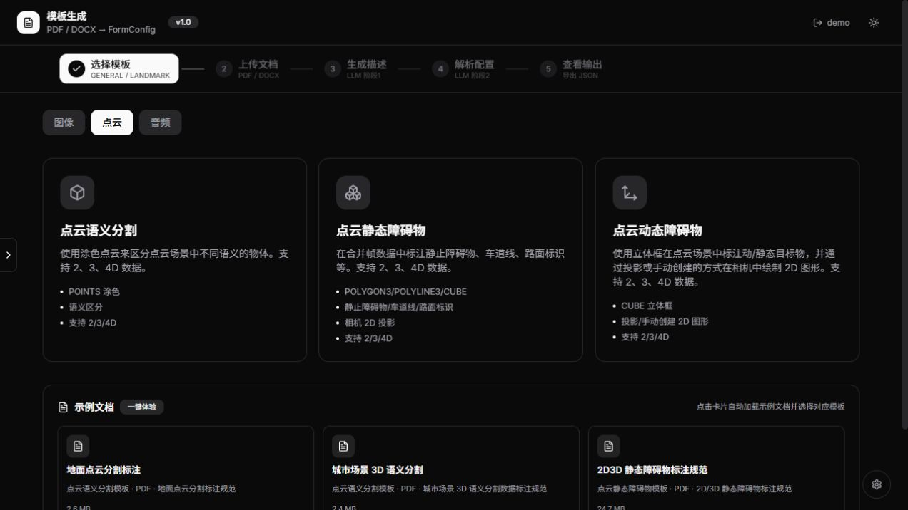

# AI 智能模板生成器（作品演示版）

> 输入标注规则文档（PDF / Word），自动生成标准标注模板配置的演示项目。
> 本仓库为脱敏后的个人作品，不包含任何内部业务数据。

## 功能简介

系统通过「文档 → 结构化模板配置」的方式，把自然语言标注规则自动映射为可编辑的标准 JSON 模板。内置 7 个模板入口：

| 类别 | 模板 |
| --- | --- |
| 图像 | 单组件 / 多组件 / 关键点 |
| 点云 | 语义分割 / 静态障碍物 / 动态障碍物 |
| 音频 | 多通道转写 |

## 核心流程

1. **上传文档**：导入标注规则 PDF / Word；
2. **LLM 解析**：理解文档语义，区分帧属性 / 物体属性 / 组件属性、标注工具、层级分类与联动规则；
3. **模板配置**：生成字段、图结构、条件 / 效果 / 校验规则（FormConfig）；
4. **预览导出**：分步确认后导出标准 JSON。

## 快速启动

环境要求：Node.js ≥ 18（零第三方依赖）。

```bash
node server.mjs
```

浏览器访问：<http://127.0.0.1:8790/label_template/>

如需换端口：

```bash
PORT=8791 node server.mjs
```

演示登录账号：`demo@example.com`（任意密码）。

## 目录结构

```
label-template-demo/
├── index.html               # 页面入口（真实构建产物）
├── assets/                  # React 前端静态资源（无 sourcemap）
├── server.mjs               # 零依赖 Node mock 后端（内置 API）
├── demoData.mjs             # 脱敏示例数据（图像 / 关键点 / 音频 / 点云）
├── data/                    # 点云标准 JSON 示例
│   ├── semantic-segmentation.json
│   ├── static-obstacle.json
│   └── dynamic-obstacle.json
├── examples/                # 占位示例文档（PDF / Word）
└── screenshot-*.jpg          # 页面效果截图
```

## 技术要点

- **前端**：React + Vite 构建（页面交互与线上版一致）；
- **后端**：Node 内置 `http` 模块，无任何 npm 依赖；
- **文档解析**：LLM 从标注规则中提取分类层级、标注工具（矩形 / 关键点 / 涂色 / 立体框等）、帧属性、组件属性、质检分类；
- **标准 JSON**：`fields + graph + conditions + effects + rules` 的 FormConfig 结构，支持单选联动、分级分类与属性校验。

## 截图




